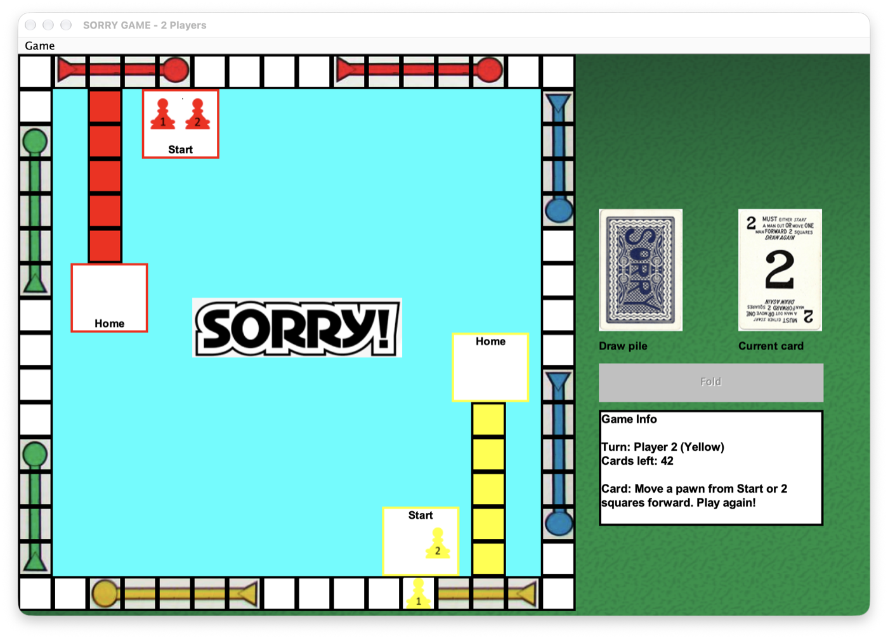

# Sorry Board Game

[](https://github.com/vgiaramazidis/sorry-board-game/actions/workflows/java-ci.yml)


A desktop implementation of the **Sorry!** board game, written with Java 8 and Swing. It began as an individual HY252 Object-Oriented Programming assignment at the University of Crete and was modernized in 2026 with multiplayer support, save/load, automated tests, and a cleaner build.

## Screenshot



## Features

- Local games for 2, 3, or 4 players
- Explicit or random first-player selection
- All assignment cards: 1, 2, 3, 4, 5, 7, 8, 10, 11, 12, and Sorry!
- Slides, captures, Safety zones, exact Home entry, split 7, and repeat turns
- Save and resume between turns using a validated, human-readable snapshot file
- JUnit regression tests for the model and controller
- Warning-free API documentation and a generated Javadoc JAR
- Java 8-compatible source and bytecode

The implementation follows the assignment rules, which intentionally differ in places from the commercial board game. For example, cards 3 and 5 move every pawn that can legally move, while cards 8 and 12 may be exchanged for another draw.

## Requirements

- JDK 8 or newer
- Maven 3.6 or newer (recommended)
- A graphical desktop environment for the Swing UI

## Build, test, and run

```bash
mvn test
mvn package
java -jar target/sorry-game-1.0.0-SNAPSHOT.jar
```

The first Maven run downloads JUnit and the build plugins. The Ant file is kept for compatibility with the original assignment:

```bash
ant clean-build
ant test
ant run
```

`ant test` delegates to Maven so both build paths run the same test suite. Running plain `ant` builds the JAR but does not unexpectedly open the game.

## How to play

1. Choose 2–4 players.
2. Choose the first player or select **Random**.
3. Click the face-down card to draw.
4. Use the dialog to choose the card action and pawn. Unavailable choices are disabled.
5. Use **Fold** only when no legal move exists (card 11 may also be folded instead of swapping, as required by the assignment).
6. Move both pawns into Home to win.

The **Game** menu can resume a saved game or save and exit. Automatic saves use:

- macOS/Linux: `~/.sorry-game/snapshot.properties`
- Windows: `%USERPROFILE%\.sorry-game\snapshot.properties`

Saving is allowed between turns so a snapshot never represents a half-finished move.

## Project structure

```text
src/main/              Application entry point
src/view/              Swing board and dialogs
src/controller/        Game coordination and turn state
src/model/             Players, pawns, deck, cards, and squares
src/model/save/        Snapshot model and persistence
src/image/             Board, card, and pawn artwork
test/                  JUnit tests
docs/                  Architecture and assignment-compliance notes
```

See [docs/architecture.md](docs/architecture.md) for the interaction flow, [docs/assignment-compliance.md](docs/assignment-compliance.md) for the checklist derived from the supplied assignment PDF, and [docs/manual-testing.md](docs/manual-testing.md) for the checks performed in the running Swing application.

## Current UI limitation

The board uses a fixed 1100 × 780 coordinate system because the supplied artwork and the assignment's `JLayeredPane` approach are pixel-based. Resizing is disabled so pawns and squares cannot drift out of alignment. A future responsive UI would require scaling every board coordinate and image together.

## Status

The non-GUI rules have automated coverage and the Maven build is suitable for continuous integration. Strict Javadoc generation is enforced with warnings treated as build failures. macOS visual smoke tests now cover 2-, 3-, and 4-player setup, explicit first-player selection, three-player turn wraparound, drawing and folding, pawn selection and movement, dialog layout, close cancellation, save-during-turn validation, and the repeat turn granted by card 2. Complete multiplayer matches and a disposable UI-level save/resume round trip are still recommended as final manual checks.

## License

No license has been selected yet. Until a license is added, copyright law reserves all rights. Choose a license before inviting outside contributions or reuse.

This is an educational, unofficial project and is not affiliated with or endorsed by the owner of the Sorry! trademark.
