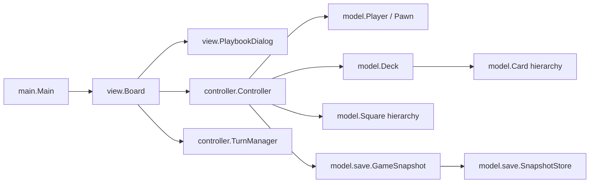
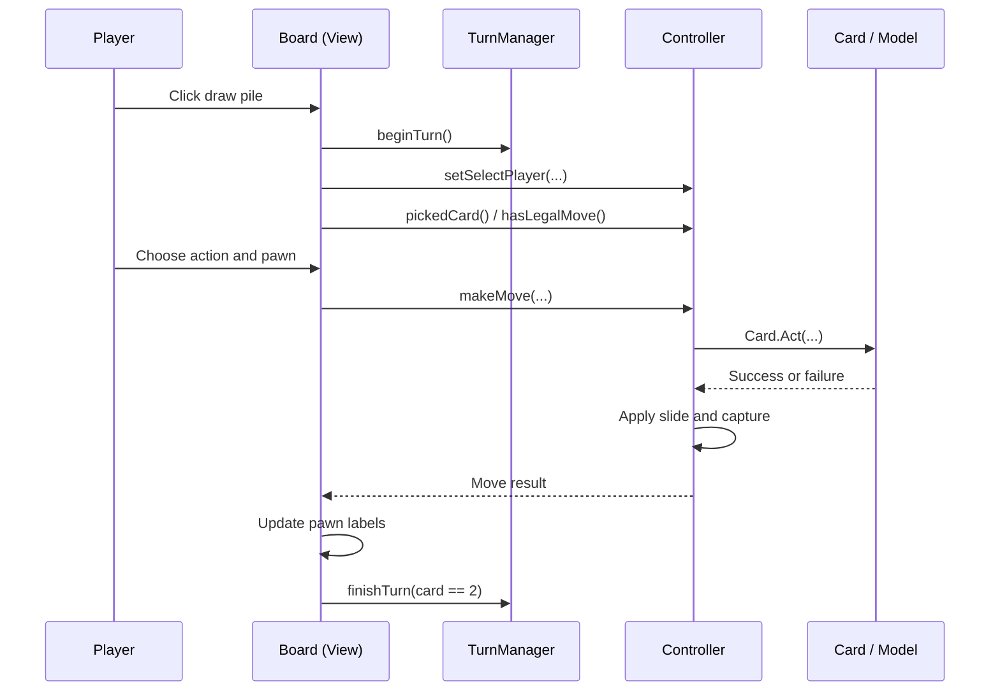

# Architecture

The project uses the assignment's Model–View–Controller split. “MVC” means that game data and rules are kept separate from the buttons and labels that display them.

## Responsibilities

- `Main` starts Swing on the Event Dispatch Thread and collects the player count and first-player choice.
- `Board` creates the Swing components, translates user choices into controller calls, and redraws pawn labels after successful actions.
- `PlaybookDialog` is a view-only, modal rules guide. It owns its page content and navigation but does not read or change game state.
- `TurnManager` records who draws next and implements normal advance or repeat-turn behavior.
- `Controller` builds the board, validates legal actions, delegates movement to the current `Card`, applies captures/slides, and creates or restores snapshots.
- `Deck` owns the 44-card shuffled draw order.
- The `Card` hierarchy uses polymorphism: the controller calls `Act(...)`, and the concrete card class supplies the relevant movement.
- The `Square` hierarchy represents ordinary, Start, Safety, Home, and Slide positions.
- `SnapshotStore` serializes immutable snapshot data to a properties file using an atomic replace where the file system supports it.

## Turn flow

Card 2 repeats the turn even when it has no legal move and is folded. Cards 8 and 12 can voluntarily redraw without advancing the turn. Card 11 can be folded instead of swapping, even when a swap exists, as the assignment explicitly allows.

## Save/load flow

Saving is restricted to boundaries between turns. `Controller.createSnapshot(...)` records every pawn by logical location, the complete deck order, the next card index, player count, and next player. `SnapshotStore.save(...)` first writes a temporary sibling file and then replaces the destination, reducing the chance of a partially written save. Loading parses and validates the file, and `Controller.restoreSnapshot(...)` rejects duplicate/missing pawns, impossible square sharing, mismatched player counts, and invalid deck data before replacing live state.

## Known design boundary

`Board` remains large because it contains the assignment's many modal dialogs and pixel-based Swing construction. Turn state was extracted, but a full responsive-view rewrite was deliberately avoided: it would be a high-risk change with little benefit to the game rules. The model still carries square coordinates because the original assignment makes board positions responsible for their screen location; this couples the model to the current view geometry and is the main architectural debt.
